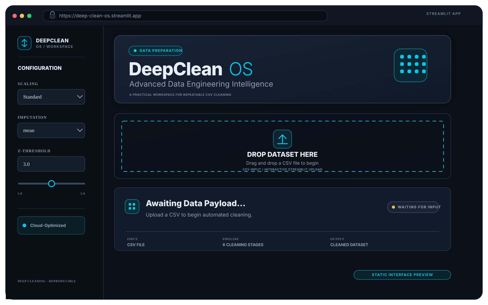
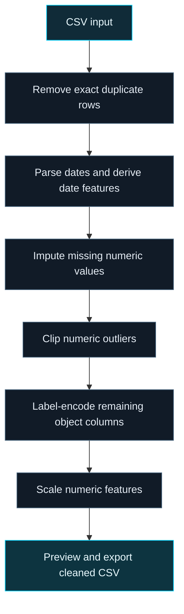

<div align="center">
  <h1>DeepClean OS</h1>
  <p><strong>A practical Python data-cleaning engine with an interactive Streamlit workspace.</strong></p>
  <p>Turn raw CSV data into a cleaner, structured starting point for analytics and machine-learning workflows.</p>
  <p>
    <a href="https://deep-clean-os.streamlit.app/"></a>
    <a href="https://github.com/Sohila-Khaled-Abbas/deep-clean-data-tool"></a>
    
    
  </p>
  <p>
    
    
    
    
    
  </p>
</div>

<p align="center">
  <a href="https://deep-clean-os.streamlit.app/">
    
  </a>
</p>
<p align="center"><sub>Static UI preview based on the current application layout and default settings. Launch the deployed app for the interactive experience.</sub></p>

---

## 01 · Project overview

**DeepClean OS** is a reusable data-preprocessing framework that applies a documented sequence of common cleaning and feature-preparation steps. It is available through two interfaces:

- **Python API** — use the `DeepClean` class in scripts and notebooks.
- **Streamlit web app** — upload a CSV, configure the cleaning options, inspect the transformation summary, preview the result, and download the cleaned dataset.

The project makes routine preprocessing repeatable and visible. It is a practical cleaning utility—not a substitute for domain-specific validation, data contracts, or production-grade feature engineering.

<p align="center">
  <a href="https://deep-clean-os.streamlit.app/"><strong>↗ Open the live DeepClean app</strong></a>
  &nbsp; · &nbsp;
  <a href="docs/architecture.md">Technical architecture</a>
  &nbsp; · &nbsp;
  <a href="notebook/data_cleaning_tool.ipynb">Exploration notebook</a>
</p>

## 02 · Capabilities

| Capability | What it does |
|---|---|
| **CSV ingestion** | Accepts a CSV file through Streamlit's file uploader. |
| **Configurable processing** | Exposes scaling method, numeric imputation strategy, and Z-score threshold controls. |
| **Sequential cleaning** | Applies the transformations in a fixed order through the `DeepClean` class. |
| **Transformation report** | Reports duplicate rows removed, date columns processed, missing values filled, outliers clipped, encoded columns, and normalization method. |
| **Result inspection** | Displays a preview of the transformed DataFrame. |
| **CSV export** | Downloads the resulting dataset from the web interface. |

## 03 · End-to-end cleaning workflow



### Transformation logic

| Stage | Implementation | Purpose |
|---|---|---|
| **1. Duplicate removal** | `DataFrame.drop_duplicates()` | Removes exact duplicate rows. |
| **2. Date processing** | `pandas.to_datetime()` | Attempts to parse object and datetime columns, then derives year, month, day, and day-of-week fields. |
| **3. Missing-value handling** | `sklearn.impute.SimpleImputer` | Fills nulls in numeric columns using mean, median, or most-frequent value. The UI's `mode` option maps to Scikit-learn's `most_frequent` strategy. |
| **4. Outlier clipping** | `scipy.stats.zscore` + standard-deviation bounds | Identifies extreme numeric values and clips values to the selected threshold bounds instead of dropping rows. |
| **5. Categorical encoding** | `sklearn.preprocessing.LabelEncoder` | Converts remaining object columns into numeric labels. |
| **6. Feature scaling** | `StandardScaler` or `MinMaxScaler` | Scales numeric columns using the selected method. |

## 04 · Web application controls

The Streamlit sidebar exposes these settings:

| Setting | Available options | Default |
|---|---|---|
| Scaling | `Standard`, `MinMax` | `Standard` |
| Imputation | `mean`, `median`, `mode` | `mean` |
| Z-threshold | `1.0`–`5.0` | `3.0` |

After a CSV is uploaded, the app displays the input row/column counts and a raw-data preview. Clicking **Initiate Pipeline** runs the configured transformations and displays the summary metrics, cleaned-data preview, and CSV export control.

## 05 · Run locally

### Requirements

- Python 3.8+
- Dependencies listed in [`requirements.txt`](requirements.txt)

### Installation

```bash
git clone https://github.com/Sohila-Khaled-Abbas/deep-clean-data-tool.git
cd deep-clean-data-tool

python -m venv .venv
```

Activate the environment and install dependencies:

```powershell
# Windows PowerShell
.venv\Scripts\Activate.ps1
python -m pip install --upgrade pip
pip install -r requirements.txt
```

For macOS or Linux, activate with `source .venv/bin/activate`.

### Start the Streamlit interface

```bash
streamlit run app.py
```

## 06 · Use the cleaning engine programmatically

```python
import pandas as pd
from src.cleaner import DeepClean

raw_df = pd.read_csv("input.csv")

cleaner = DeepClean(raw_df)
cleaner.remove_duplicates()
cleaner.process_dates()
cleaner.handle_missing_values(strategy="median")
cleaner.handle_outliers(threshold=3.0)
cleaner.encode_categorical()
cleaner.normalize_data(method="standard")

cleaned_df = cleaner.df
summary = cleaner.get_summary()

cleaned_df.to_csv("cleaned_output.csv", index=False)
print(summary)
```

For the class's default sequence, call `cleaner.clean()` after initialization. It applies mean imputation, a `3.0` outlier threshold, and standard scaling.

## 07 · Repository structure

```text
deep-clean-data-tool/
├── app.py                         # Streamlit web application
├── src/
│   └── cleaner.py                 # Reusable DeepClean processing class
├── docs/
│   └── architecture.md            # Pipeline architecture and transformation notes
├── notebook/
│   └── data_cleaning_tool.ipynb   # Data-cleaning exploration notebook
├── assets/
│   └── deepclean-ui-preview.png   # Static interface preview for this README
├── requirements.txt
├── LICENSE
└── README.md
```

## 08 · Important implementation considerations

Review these behaviours before using the output in downstream analytics or machine-learning work:

- **Imputation scope:** the current engine imputes numeric columns. It does not impute missing categorical text values.
- **Date detection:** date processing attempts to parse object and datetime columns. Review the detected fields when text values could be mistaken for dates.
- **Categorical encoding:** remaining object columns are label-encoded independently. The resulting integers are category identifiers, not meaningful rankings.
- **Scaling scope:** the selected scaler is applied to all numeric columns, including numeric date components created earlier in the workflow.
- **Missing text values:** because categorical encoding converts object values to strings, missing text values can become a literal `"nan"` category.
- **Model evaluation:** fit preprocessing transformations on training data only when preparing predictive workflows. This utility does not persist fitted transformers or enforce train/test separation.

Treat the result as a **preprocessed starting point**. Validate column types, ranges, business rules, and target-specific requirements before reporting, analysis, or model training.

## 09 · Project resources

| Resource | Link |
|---|---|
| Live web application | [deep-clean-os.streamlit.app](https://deep-clean-os.streamlit.app/) |
| Technical architecture | [`docs/architecture.md`](docs/architecture.md) |
| Exploration notebook | [`notebook/data_cleaning_tool.ipynb`](notebook/data_cleaning_tool.ipynb) |
| Streamlit interface | [`app.py`](app.py) |
| Cleaning engine | [`src/cleaner.py`](src/cleaner.py) |

## License

Released under the [MIT License](LICENSE).

---

<div align="center">
  <strong>Built by <a href="https://github.com/Sohila-Khaled-Abbas">Sohila Khaled Abbas</a></strong>
  <br>
  <sub>Data Analytics · Business Intelligence · Data Engineering</sub>
  <br>
  <a href="https://sohila-khaled-abbas.vercel.app/">Portfolio</a>
  &nbsp; · &nbsp;
  <a href="https://www.linkedin.com/in/sohilakabbas/">LinkedIn</a>
</div>
